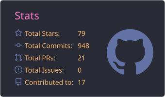
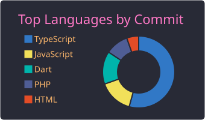

<h1 align="center">hey, i'm Farhan 👋</h1>

  Full-stack developer based in Bekasi, Indonesia 🇮🇩 
  Building APIs, data-driven services, and AI-powered products for web and mobile

  
  
  

---

## about me

Full-stack developer with nearly 5 years of experience building APIs, data-driven services, and integrations for web and mobile products, including a payment platform used by store owners across Indonesia. Currently a Full Stack Developer at Digital Mediatama Maxima.

I design systems with attention to reliability, data integrity, and maintainability. Requirements are documented in a detailed PRD before implementation, and every change goes through review and testing before release.

**core stack**
- Node.js, NestJS, Go, and Laravel for APIs and services
- PostgreSQL and MySQL for data storage
- Docker for containerization, Vercel for deployment

**current focus**
- Building API-driven products with TypeScript and Next.js
- Integrating AI into products, from receipt extraction to AI-assisted workflows
- Applying AI-assisted tooling to speed up development without compromising quality

**open to**
- Roles and collaborations centered on APIs, data, and system design
- Conversations about API design, AI integration, and AI-assisted development

---

## stack

---

## personal projects

### 💸 Boncos
[repo](https://github.com/farhanhl/boncos) · [live](https://boncos.vercel.app)

an expense tracker for anyone tired of going boncos (broke). snap a receipt, the numbers get read, save it, done. receipt extraction now supports both OCR (Tesseract.js, runs in the browser) and AI. comes with Telegram alerts and CSV export too.

`Next.js` `TypeScript` `Tesseract.js` `AI` `Firebase` `Tailwind`

### 🌅 Kebiasaan
[repo](https://github.com/farhanhl/kebiasaan) · [live](https://kebiasaan.vercel.app)

a habit tracker that doesn't judge you. log good and bad habits with streaks, XP, levels, 9 badges, a mood tracker, and a dashboard with a 20-week heatmap. installable as a PWA and works offline. the UI is in Bahasa Indonesia.

`Next.js` `TypeScript` `Firebase` `Flowbite` `ApexCharts`

### 📖 e-mushaf
[repo](https://github.com/farhanhl/e-mushaf)

a digital Quran app for mobile.

`Flutter` `Dart`

### 🚴 Tiba-Tiba Cycling
[repo](https://github.com/farhanhl/tibatibacyc) · [live](https://www.tibatibacyc.my.id)

website for a cycling community in Bekasi. features ride schedules, a route map with a cyclist simulation, weather and air quality forecasts for ride times, a twibbon generator, and a link to join the community.

`Next.js`

### 🏙️ Langit Senja
[repo](https://github.com/farhanhl/langitsenja) · [play](https://langitsenja.vercel.app) · [revamp (v2)](https://github.com/farhanhl/langitsenja_v2)

a 3D hide and seek game in the browser, set in an Indonesian city. find your friends before time runs out, or night falls and scary creatures show up 👀. there are plenty of hidden gems to discover, so explore all the way. desktop only.

`Three.js` `JavaScript`

---

## enterprise projects

work from my day job and clients, so most of the source code is private. more details on my [portfolio](https://farhanhl.dev).

### 🎙️ Close The Door
[live](https://closethedoor.com)

web app for the Close The Door podcast by Deddy Corbuzier.

`Angular` `Laravel` `MySQL`

### 💳 Pojok Bayar
[Play Store](https://play.google.com/store/apps/details?id=com.nfcxc.src&hl=id)

a digital payment app for SRC store owners across Indonesia: mobile credit, data packages, PPOB, PLN tokens, BPJS, PDAM, e-wallet top-ups, and more.

`Flutter` `.NET` `SQL Server`

### 🧑‍💼 Digital Human
an interactive digital assistant that can talk and interact with people, used for customer service and as a virtual guide. delivered and in use at several clients.

`Flutter` `Dart` `AI`

### 📡 Smart Sensor
a monitoring dashboard for store activity data: planogram distribution, signage status, sensor sync, and content performance. helps teams track device health and visitor interaction patterns in real time.

`Angular` `Node.js` `Express`

### ✈️ IERApps
a corporate mobile app for aircraft component management and knowledge sharing across teams.

`Flutter` `GraphQL` `PostgreSQL`

---

## stats

  
  

---

## hit me up

got a project idea, want to collab, or just wanna talk code? check out [farhanhl.dev](https://farhanhl.dev), find me on [LinkedIn](https://linkedin.com/in/farhanhl) or [Instagram](https://instagram.com/0xfarhanhl), or open an issue/DM me here.
